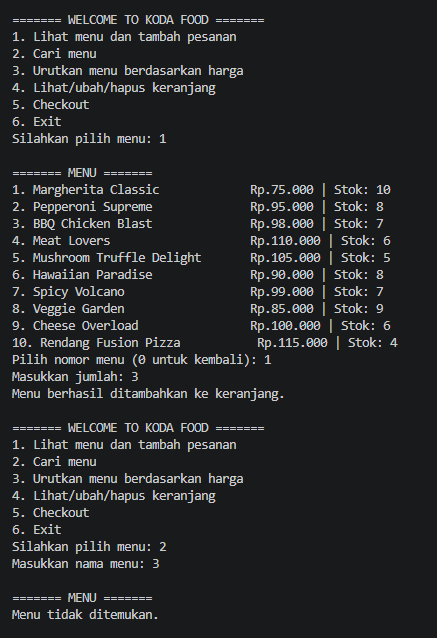
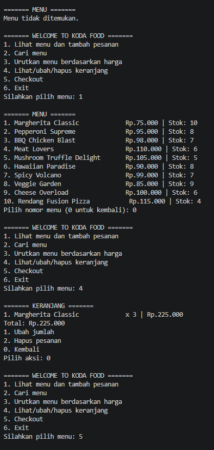
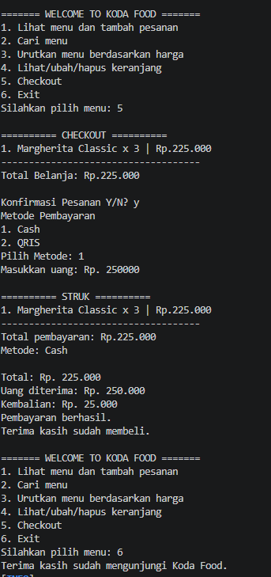

# Food Ordering System (Java & .NET)

A robust and object-oriented Food Ordering System implemented in Java and .NET. This project showcases standard software design principles, structured services, and clean console-based user interactions.

---

## 🏗️ Struktur Class

Program ini dibagi menjadi beberapa lapisan *class* berdasarkan tanggung jawabnya masing-masing:

### Core & UI
* **App**: Penggerak utama program yang bertugas untuk menginisialisasi dan memanggil semua objek class yang diperlukan.
* **Home**: Menangani tampilan User Interface (UI) di konsol dan mengatur alur logika navigasi utama program.

### Data Models
* **Menu**: Menyimpan cetak biru objek hidangan/makanan yang dibuat melalui *constructor*.
* **Cart**: Menyimpan cetak biru objek item keranjang belanja belanja beserta kuantitasnya.

### Services (Logic Layers)
* **MenuService**: Mengelola semua logika terkait menu, mulai dari inisialisasi daftar menu (*list*), pengurutan berdasarkan harga, pencarian menu, hingga menampilkan daftar menu ke layar.
* **CartService**: Mengelola semua logika terkait keranjang belanja belanja, termasuk menambahkan item ke *list*, memperbarui jumlah pesanan berdasarkan nama, menghapus item berdasarkan indeks, menghitung total belanja, mengecek ketersediaan stok, menampilkan isi keranjang, hingga mengosongkannya jika pembayaran sukses.
* **CheckoutService**: Mengelola alur transaksi akhir, mulai dari pengecekan validitas isi keranjang, konfirmasi total pembayaran, pemilihan metode pembayaran dengan validasi input, hingga pencetakan struk belanja (*receipt*).

### Payment Layer
* **PaymentMethod (Interface)**: Kontrak abstrak yang mendefinisikan metode pembayaran wajib untuk class yang mengimplementasikannya.
* **Payment (Abstract Class)**: Class induk (*parent*) yang menyediakan properti dasar serta mewariskan metode ke class anak.
* **CashPayment**: Class anak (*child*) yang mengimplementasikan pembayaran tunai dan melakukan *override* metode pembayaran.
* **QrisPayment**: Class anak (*child*) yang mengimplementasikan pembayaran non-tunai via QRIS dan melakukan *override* metode pembayaran.

---

## 🧩 Konsep OOP yang Digunakan

Proyek ini menerapkan 4 pilar utama **Object-Oriented Programming (OOP)** secara ketat:

1. **Inheritance (Pewarisan)**
   * `Payment` bertindak sebagai *parent class* yang mewariskan atribut serta metodenya ke *child class* yaitu `CashPayment` dan `QrisPayment`.
2. **Abstraction (Abstraksi)**
   * Menggunakan kontrak universal via interface `PaymentMethod` dan struktur dasar terproteksi via abstract class `Payment`.
3. **Encapsulation (Penyembunyian Data)**
   * Melindungi integritas data menu dengan menyetel aksesibilitas variabel menjadi `private final List<Menu>` di dalam `MenuService`.
4. **Polymorphism (Banyak Bentuk)**
   * Menerapkan *Runtime Polymorphism* melalui *method overriding* pada class `CashPayment` dan `QrisPayment` terhadap metode yang diwajibkan oleh interface.

---

## 🚀 Cara Menjalankan

### Java (Maven)
Jalankan perintah berikut pada terminal di direktori proyek Java Anda:
```bash
mvn clean compile exec:java
```
*atau jika hanya ingin langsung mengeksekusi tanpa membersihkan berkas lama:*
```bash
mvn compile exec:java
```

### .NET
Jalankan perintah berikut pada terminal di direktori proyek .NET Anda:
```bash
dotnet run
```

---

## 📷 Screenshot Aplikasi

Berikut adalah pratinjau tampilan antarmuka sistem pemesanan berbasis konsol:


*Gambar 1: Tampilan Menu Utama dan Daftar Makanan*


*Gambar 2: Manajemen Keranjang Belanja*


*Gambar 3: Proses Checkout dan Cetak Struk Pembayaran*
